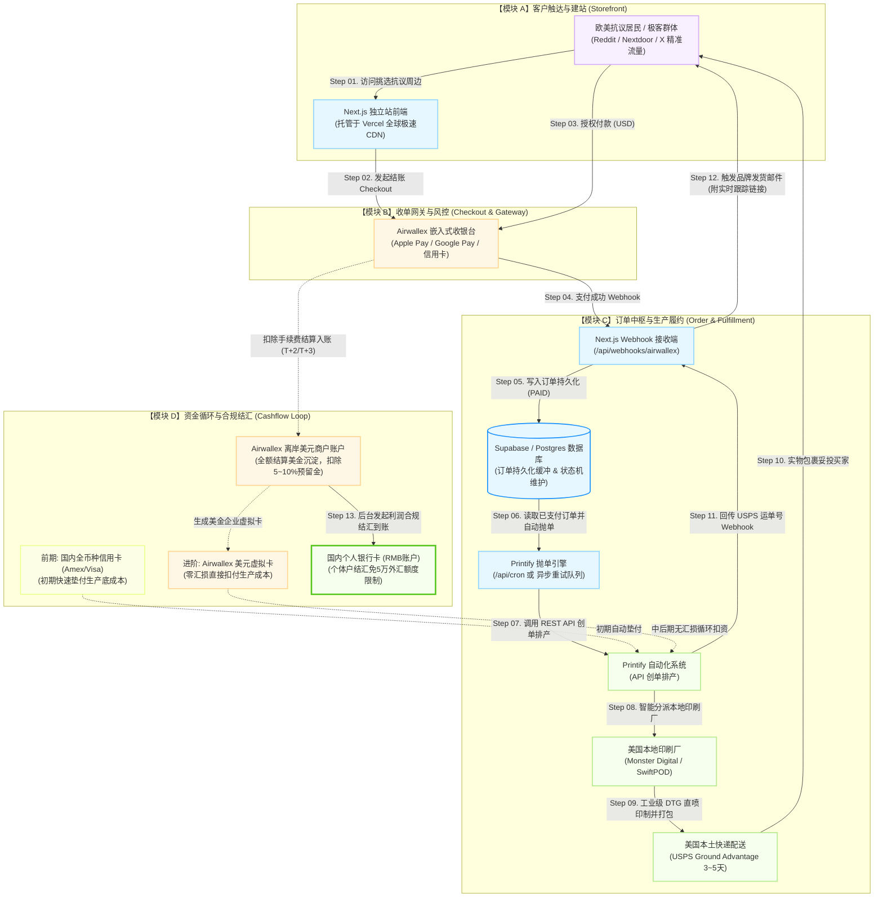

# 独立站跨境出海全链路商业与系统架构指南 (工业级标准)
> **项目**：Tomato Raccoon (番茄小浣熊 · 抗议数据中心主题周边)  
> **核心模式**：自研 Next.js 14 + Printify POD (按需印制) + Airwallex (空中云汇) 跨境收单  
> **版本**：v2.1 (序号体系与层次规范化重构版)  
> **更新时间**：2026-11-10

---

## 一、 工业级业务闭环全景流程图 (Business Architecture)

---

## 二、 4 大关键优化与系统鲁棒性保障 (Robustness)

### 保障 1：逆向物流与发货追踪闭环 (Tracking Webhook)
* **痛点**：Printify 默认发出的邮件可能不具备你的品牌域名，买家体验割裂。
* **工业级实现**：
  * **步骤 ①**：Printify 在工厂生成 USPS 运单贴标后，主动向 Next.js 发送 `order:shipment:created` Webhook。
  * **步骤 ②**：Next.js 接收到运单号（如 `USPS 9400xxxx`）后，更新数据库订单状态为 `SHIPPED`。
  * **步骤 ③**：自动触发自研邮件服务（通过 **Resend / SendGrid**），给买家发送带有番茄小浣熊品牌 Header、退换货指南与专属追踪链接的正式发货通知。
  * **步骤 ④**：网站内置 `/track-order` 页面，买家输入邮箱或订单号即可实时呈现物流轨迹。

### 保障 2：系统持久化缓冲与状态机防崩 (State Machine)
* **痛点**：若在支付成功 Webhook 里直接裸调 Printify API，遇 Printify 临时 502、买家美国地址校验失败（如 Zipcode 与 City 不匹配）或底衫缺货，订单直接丢失。
* **工业级实现**：
  * **阶段 ① (PAID 持久化)**：Airwallex 扣款成功后，首先将完整 Payload 写入数据库（**Supabase / PostgreSQL / Neon**），打上 `PAID` 标记。哪怕后端此时断电崩溃，数据绝不丢失。
  * **阶段 ② (FULFILLING 异步抛单)**：由专门的异步执行器（Queue / Retry Worker）读取订单并向 Printify 抛单。
  * **阶段 ③ (FAILED_RETRY 异常重试)**：若 Printify 抛单失败，状态标记为 `FULFILLMENT_FAILED`，系统自动飞书/邮件告警并支持 3 次幂等自动重试，彻底杜绝拒付 (Chargeback)。

### 保障 3：Airwallex 美元虚拟卡 (Borderless Card) 零汇损垫资
* **痛点**：前期使用国内全币种信用卡（Amex/Visa）垫资，国内银行扣款通常存在 1%~3% 的境外货币转换费或汇率点差。
* **最优资金解法**：
  * **前期 (信用卡起步)**：利用国内信用卡提供的 30~50 天免息期快速垫资跑通流水。
  * **中后期 (虚拟卡闭环)**：当 Airwallex 账户积累了买家支付的美元后，在 Airwallex 后台一键生成一张 **美金企业虚拟卡 (Airwallex Borderless Card)** 并绑定在 Printify 支付方式上。
  * **零汇损循环**：直接用赚到的美元原币扣付 Printify 的美元成本，**无任何二次汇率磨损**，仅将纯利润部分在离岸账户一键结汇成人民币！

### 保障 4：滚动预留金 (Rolling Reserve) 现金流预算与风控
* **风控常识**：对于初创的个体户/新域名独立站，Airwallex 或任何正规国际收单网关通常会设置 **5%~10% 的滚动保证金（Rolling Reserve，通常质押 90~180 天）**，以防范恶意盗刷拒付风险。
* **财务预算**：初期利润核算与流动资金周转需预留 10% 缓冲垫，随着订单正常发货妥投、争议率低于 0.5%，保证金将按批次全额滚回可用余额。

---

## 三、 单件商品毛利测算表 (Unit Economics)

| 商品名称 | Printify 基础成本 (含运费估算) | 独立站建议零售价 (USD) | 支付手续费 (约 3.2%+$0.3) | 单件净利润 (USD) | 单件净利润 (折合 RMB) |
| :--- | :---: | :---: | :---: | :---: | :---: |
| **Comfort Colors 1717 经典短袖** | ~$13.50 | **$32.00** | ~$1.32 | **+$17.18** | **~￥124** |
| **Gildan 18500 连帽卫衣** | ~$22.00 | **$48.00** | ~$1.84 | **+$24.16** | **~￥174** |
| **草坪标语牌 (Yard Sign 带支架)** | ~$12.00 | **$28.00** | ~$1.20 | **+$14.80** | **~￥107** |
| **车尾标贴 (Bumper Sticker)** | ~$4.50 | **$12.00** | ~$0.68 | **+$6.82** | **~￥49** |
| **高光模切贴纸 (Kiss-Cut Sticker)** | ~$3.20 | **$8.00** | ~$0.56 | **+$4.24** | **~￥31** |

---

## 四、 Airwallex 线上收单审核“四大必备合规页面”检查

在正式向 Airwallex 提交网站审核时，以下 4 个页面工程内已全部就位（可在 `tomato-raccoon/app/` 下查阅）：

* **[合规项 A] Shipping Policy (运输政策，`/shipping-policy`)**：明确标注由美国本土印刷厂生产、通过 USPS 配送、制作周期 2~3 个工作日、运输时效 3~5 个工作日。
* **[合规项 B] Refund & Return Policy (退换货政策，`/refund-policy`)**：POD 属于个性化定制商品，明确标明：“除印刷质量瑕疵或破损免费重印/退款外，尺码选错等个人原因原则上不支持退货”。
* **[合规项 C] Contact Us (联系我们，`/contact`)**：清晰公布官方客服邮箱（`growtomatoes.service@outlook.com`）与服务响应时效（24小时内答复）。
* **[合规项 D] Terms of Service & Privacy Policy (服务条款与隐私政策，`/terms-of-service` & `/privacy-policy`)**：完整的消费者权益、数据保护声明与合规免责条款。

---

## 五、 全流程执行清单 (Action Checklist)

### 阶段 1：已就绪技术基建 (Done)
- [x] **Printify API 连通**：已完成 Token 绑定与真实商品 ID 录入。
- [x] **垫资信用卡绑定**：已完成 Printify 支付方式绑定。
- [x] **个体工商户营业执照申报**：已完成嵊州政务网全流程线上申报。
- [x] **合规政策页面部署**：运输政策、退货条款、联系方式等 4 大合规页已完成工程内置。

### 阶段 2：上线与收单投产 (Pending)
- [ ] **域名选定与购买**：选定品牌域名（约 $10/年）。
- [ ] **Vercel 全球部署**：代码推送到 GitHub，绑定 Vercel 并解析域名。
- [ ] **执照 PDF 领证**：收到短信后在“电子营业执照”小程序下载高清副本。
- [ ] **Airwallex 线上收单开户**：提交执照 + 独立站域名开通跨境收银台。
- [ ] **数据库持久化连接**：接入 Supabase 写入订单状态机与重试任务。
- [ ] **生成美元虚拟卡**：从 Airwallex 生成企业卡绑定至 Printify 实现零汇损循环。
