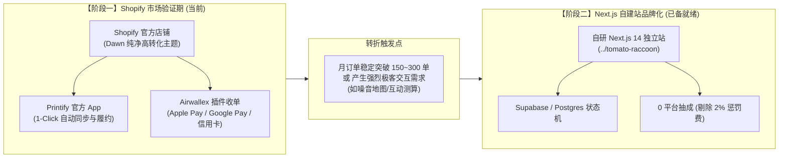

# Tomato Raccoon (番茄小浣熊) · Shopify 极速出海商业阵地

> **项目定位**：北美“抗议数据中心”抗争主题 DTC 独立站 (Virginia Data Center Alley Protest)  
> **核心模式**：Shopify (托管建站) + Printify (官方 App 自动化 POD) + Airwallex (跨境多币种收单)  
> **阶段战略**：**阶段一·极速验证期 (Fast Market Validation)** —— 规避过度工程化，聚焦流量、转化与真实抗议者购买验证。

---

## 一、 为什么在阶段一选用 Shopify？

在前期自研 Next.js 14 架构（详见 [`../tomato-raccoon`](file:///C:/All/Me/2027/work/Shopify/tomato-raccoon)）的过程中，我们已经验证了全链路技术可行性。但在商业起步阶段，时间与转化率是生命线：

1. **Printify 官方插件降维打击**：
   - 在 Printify 后台创建的 5 款抗议核心周边，点击 **Publish** 即可 1 秒同步至 Shopify。
   - 所有尺码、款式变体、颜色、高清效果图（Mockups）、实时库存状态全自动映射，无需手写变体数据库。
   - 买家付款后，Shopify 自动将地址与款式推送给 Printify 本地工厂生产；工厂打印 USPS 面单后，Shopify 自动触发带地图轨迹的官方发货邮件，**0 行后端代码实现闭环**。
2. **欧美买家的结账信任度与 Shop Pay**：
   - 欧美消费者对陌生网站高度警惕。Shopify 的标准结账页与 **Shop Pay（数千万欧美买家一键免密闪付）** 是全球电商转化率天花板，能将自建站常见的 15%~30% 结账弃单率降至最低。
3. **把 80% 精力聚焦在“卖货与社区引流”**：
   - 抗议周边的核心瓶颈是 **Reddit / Nextdoor / X 上受数据中心噪音、高电价困扰的弗吉尼亚当地居民是否愿意掏 $32 买这件 T 恤**。
   - 使用 Shopify 仅需 1 天即可开店推向市场，极大缩短试错周期。

---

## 二、 渐进式双轨演进策略 (Progressive Roadmap)

---

## 三、 本目录核心执行文件导引

| 规范文档 | 核心内容与目的 |
| :--- | :--- |
| **[`SHOPIFY_FAST_TRACK.md`](file:///C:/All/Me/2027/work/Shopify/tomato_raccoon_shopify/SHOPIFY_FAST_TRACK.md)** | **1 天极速上线标准 SOP**：注册开店、绑定免费 Dawn 主题、Printify 官方 App 连接、Airwallex 收单挂载、域名配置全流程。 |
| **[`PRODUCTS_AND_PRICING.md`](file:///C:/All/Me/2027/work/Shopify/tomato_raccoon_shopify/PRODUCTS_AND_PRICING.md)** | **5 款核心单品与毛利测算表**：Comfort Colors 1717 T恤、Gildan 连帽卫衣、草坪标语牌、车尾贴的真实售价、扣除 Shopify $39 月租 + 2% 交易费后的单件纯利润。 |
| **[`POLICIES_TEMPLATES.md`](file:///C:/All/Me/2027/work/Shopify/tomato_raccoon_shopify/POLICIES_TEMPLATES.md)** | **开店必备 4 大合规政策**：针对 Shopify 后台 `Settings -> Policies` 格式定制的运输、退换货、服务条款与联系信息文本。 |
| **[`COMMUNITY_LAUNCH_PLAYBOOK.md`](file:///C:/All/Me/2027/work/Shopify/tomato_raccoon_shopify/COMMUNITY_LAUNCH_PLAYBOOK.md)** | **欧美社群极速冷启动指南**：Reddit（r/nova、r/Virginia）、Nextdoor 社区真诚发帖文案模板、抗议口号与带货转化技巧。 |
